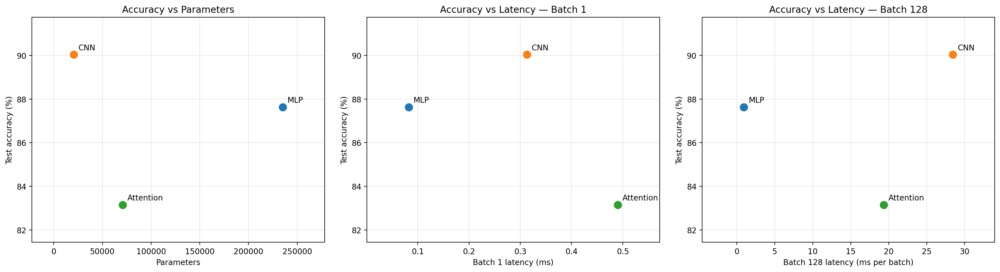

# Lab 3: Architectures and Their Costs

## Setup
I compared an MLP, a CNN and an attention model on Fashion-MNIST.
I used 55,000 training, 5,000 validation and 10,000 test images.
I applied ToTensor() and Normalize((0.2860,), (0.3530,)).
Each model was trained for 5 epochs with Adam, lr=0.001 and batch size 128.

I followed the architectures listed in the manual. Their parameter
counts do not match the stated 100k-150k target, so this comparison
uses models of different sizes.

## Results
| Model | Parameters | Test accuracy | Batch 1 (ms) | Batch 128 (ms) |
|---|---:|---:|---:|---:|
| MLP | 235,146 | 87.63% | 0.0824 | 0.9236 |
| CNN | 20,490 | 90.03% | 0.3131 | 28.4523 |
| Attention | 70,794 | 83.15% | 0.4903 | 19.3604 |

Latency was measured before training on cpu, using
PyTorch 2.11.0+cpu and 1 CPU thread(s).
I used eval and inference modes, 10 warm-up runs, and the median of
100 runs for batch 1 and 20 runs for batch 128. Data loading was
excluded. Batch 128 values are times for the whole batch.

## Computation
I used 2 FLOPs per multiply-accumulate operation.
Example calculations for one image:

- Linear: 2 * 784 * 256 = 401,408 FLOPs.
- Conv: 2 * 3 * 3 * 1 * 16 * 28 * 28 = 225,792 FLOPs.
- Attention QKV: 2 * 16 * 64 * 192 = 393,216 FLOPs.

| Model | Manual FLOPs | THOP MACs | 2 * THOP MACs |
|---|---:|---:|---:|
| MLP | 469,504 | 234,752 | 469,504 |
| CNN | 2,063,488 | 1,031,744 | 2,063,488 |
| Attention | 2,329,856 | 591,488 | 1,182,976 |

The manual totals count the main matrix and convolution operations,
excluding bias, activations, pooling, normalization and softmax.
MLP and CNN matched THOP after the MAC-to-FLOP conversion.
THOP missed the full MultiheadAttention cost and included
normalization, which explains the attention difference.

## Plots

## My conclusion
The CNN had the highest accuracy and the fewest parameters.
Its local filters reuse weights across image positions, making
it a good choice when accuracy and model size matter.

The MLP was fastest on this CPU. It uses dense matrix operations,
and batching reuses weights across images. It needs more parameters
but is a good choice when latency matters most.

Attention compares all patch pairs and needs extra intermediate
data such as Q, K, V and attention scores. It was less accurate here.
This version has no positional encoding, so mean pooling loses
patch-order information.

For this experiment, I would choose CNN for accuracy and compactness,
or MLP for speed. The results are from one five-epoch run with
different model sizes, so they do not show a universal winner.
